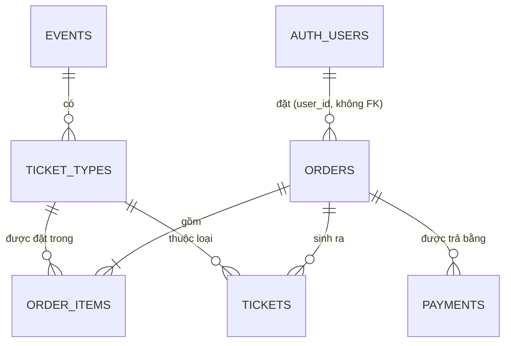

# TicketHub — Thiết kế hệ thống

> Hệ thống bán vé sự kiện. Bài toán cốt lõi: **mở bán 1.000 vé, 10.000 người bấm mua cùng lúc** —
> không bán vượt, không trừ tiền hai lần, không mất email vé, không sập.
>
> Dựng trên template `ca-api` (.NET 10, Clean Architecture, CQRS, EF Core + Dapper, PostgreSQL, Redis, module đăng nhập).

**Mục lục**

1. [Yêu cầu](#1-yêu-cầu)
2. [Mô hình dữ liệu](#2-mô-hình-dữ-liệu)
3. [Chức năng theo ticket](#3-chức-năng-theo-ticket)
4. [Quy trình làm một ticket](#4-quy-trình-làm-một-ticket)
5. [Tiến độ](#5-tiến-độ)

---

## 1. Yêu cầu

### 1.1 Vai trò

| Vai trò | Làm được |
|---|---|
| **Admin / Manager** (ban tổ chức) | Tạo, sửa, công bố, huỷ sự kiện; tạo loại vé; xem đơn hàng |
| **User** (khách mua) | Xem sự kiện đang bán; đặt vé; thanh toán; xem đơn và vé của mình; huỷ đơn chưa thanh toán |
| **Khách chưa đăng nhập** | Chỉ xem danh sách và chi tiết sự kiện |
| **Hệ thống** (tự chạy) | Tự huỷ đơn giữ chỗ quá hạn; nhận kết quả thanh toán; gửi email vé |

Tài khoản và vai trò dùng module đăng nhập có sẵn (`auth.users`, `auth.user_roles`; hằng `Roles.Admin/Manager/User`).

### 1.2 Yêu cầu phi chức năng — phần làm nên giá trị dự án

| # | Yêu cầu | Ticket |
|---|---|---|
| NFR-1 | **Không bao giờ bán vượt** số vé, kể cả khi hàng nghìn người mua cùng lúc | 3 |
| NFR-2 | **Không trừ tiền / xuất vé hai lần** khi client bấm 2 lần hoặc cổng thanh toán gọi lại 2 lần | 4 |
| NFR-3 | **Không mất email vé** khi service gửi mail đang sập | 5 |
| NFR-4 | Trang xem sự kiện **chịu tải lớn** | 6 |
| NFR-5 | Có **số liệu đo được** (k6) chứng minh NFR-1 dưới tải | 7 |

---

## 2. Mô hình dữ liệu

### 2.1 Cách suy ra bảng từ yêu cầu

1. Gạch chân các **danh từ** trong yêu cầu: *sự kiện, loại vé, đơn hàng, vé, thanh toán*.
2. Danh từ nào **có vòng đời riêng** (được tạo, đổi trạng thái, tra cứu độc lập) → thường là một bảng.
3. Xét quan hệ **một – nhiều** giữa chúng → khoá ngoại.
4. Thêm cột cho **từng luật nghiệp vụ** (vd "giữ chỗ 10 phút" → cột `expires_at`).
5. Thêm **index** theo đúng các câu truy vấn sẽ chạy nhiều nhất.

### 2.2 Sơ đồ quan hệ



`outbox_messages` là bảng kỹ thuật (Ticket 5), không có quan hệ khoá ngoại.

### 2.3 `events` — sự kiện *(Ticket 1)*

| Cột | Kiểu | Ghi chú |
|---|---|---|
| `id` | `uuid` | UUID v7 |
| `name` | `varchar(200)` | bắt buộc |
| `description` | `text` | |
| `venue` | `varchar(300)` | địa điểm |
| `starts_at`, `ends_at` | `timestamptz` | thời gian diễn ra |
| `sale_starts_at`, `sale_ends_at` | `timestamptz` | thời gian mở bán |
| `status` | `varchar(20)` | `Draft` → `Published` → `Cancelled` |
| `created_at/by`, `updated_at/by` | | interceptor audit tự điền (`IAuditableEntity`) |
| `is_deleted`, `deleted_at/by` | | xoá mềm (`ISoftDeletable`) |

- **Luật:** `sale_starts_at < sale_ends_at ≤ starts_at < ends_at`. Chỉ `Draft` mới sửa được thông tin. Công bố cần ≥ 1 loại vé.
- **Index:** `(status, starts_at)` — trang danh sách lọc theo đúng 2 cột này.

### 2.4 `ticket_types` — loại vé *(Ticket 1)*

| Cột | Kiểu | Ghi chú |
|---|---|---|
| `id` | `uuid` | |
| `event_id` | `uuid` FK → `events` | |
| `name` | `varchar(100)` | VIP, Thường… — unique trong cùng sự kiện |
| `price` | `numeric(18,2)` | |
| `total_quantity` | `int` | tổng số vé phát hành |
| `available_quantity` | `int` | **số vé còn lại** — cột trung tâm của Ticket 3 |
| `max_per_order` | `int` | mỗi đơn mua tối đa bao nhiêu |
| `xmin` (ẩn) | | concurrency token cho cách làm optimistic ở Ticket 3 |

> **Quyết định thiết kế**
> - **Vì sao có `available_quantity`, không tính `total − tổng đã bán`?** Tính bằng `SUM` mỗi lần mua vừa chậm vừa **không khoá được**
>   khi nhiều người mua cùng lúc. Một cột số để trừ trực tiếp là cách duy nhất làm phép trừ nguyên tử.
> - **`CHECK (available_quantity >= 0)`** ở tầng DB: lớp chặn cuối — code có sai thì DB cũng không cho số vé âm.

### 2.5 `orders` + `order_items` — đơn hàng *(Ticket 2)*

**`orders`**

| Cột | Kiểu | Ghi chú |
|---|---|---|
| `id` | `uuid` | |
| `code` | `varchar(30)` unique | mã cho người đọc, vd `TH-20261109-7F3K` |
| `user_id` | `uuid` | người mua — **không FK** sang `auth.users` (khác DbContext, khác schema) |
| `status` | `varchar(20)` | `Pending` → `Paid` / `Expired` / `Cancelled` |
| `total_amount` | `numeric(18,2)` | |
| `expires_at` | `timestamptz` | hết hạn giữ chỗ = lúc tạo + 10 phút |
| `paid_at` | `timestamptz` | |
| `idempotency_key` | `varchar(100)` | Ticket 4 — unique theo `(user_id, idempotency_key)` |
| audit | | |

- **Index:** `(status, expires_at)` cho job quét đơn hết hạn; `(user_id, created_at)` cho trang "Đơn của tôi".

**`order_items`**

| Cột | Kiểu | Ghi chú |
|---|---|---|
| `id`, `order_id` FK | | |
| `ticket_type_id` FK | | |
| `quantity` | `int` | > 0 |
| `unit_price` | `numeric(18,2)` | **chụp lại giá lúc đặt** |

> **Vì sao lưu `unit_price`?** Ban tổ chức đổi giá sau khi khách đã đặt thì đơn cũ vẫn phải giữ giá cũ —
> không chụp lại là hoá đơn sai.

### 2.6 `payments` — thanh toán *(Ticket 4)*

| Cột | Kiểu | Ghi chú |
|---|---|---|
| `id`, `order_id` FK | | |
| `provider` | `varchar(30)` | `Mock` (giả lập cổng thanh toán) |
| `provider_transaction_id` | `varchar(100)` **unique** | **chìa khoá idempotency**: webhook gọi lại 2 lần chỉ ghi 1 lần |
| `amount` | `numeric(18,2)` | |
| `status` | `varchar(20)` | `Pending` / `Succeeded` / `Failed` |
| `raw_payload` | `jsonb` | nguyên dữ liệu cổng thanh toán gửi về, để đối soát |

### 2.7 `tickets` — vé điện tử *(Ticket 4)*

| Cột | Kiểu | Ghi chú |
|---|---|---|
| `id`, `order_id` FK, `ticket_type_id` FK | | |
| `code` | `varchar(32)` unique | chuỗi ngẫu nhiên, in thành QR |
| `status` | `varchar(20)` | `Valid` / `Used` / `Cancelled` |
| `issued_at` | `timestamptz` | |

Đơn mua 3 vé VIP → **3 dòng** `tickets`, mỗi vé một mã.

### 2.8 `outbox_messages` — hàng chờ sự kiện *(Ticket 5)*

| Cột | Kiểu | Ghi chú |
|---|---|---|
| `id` | `uuid` | |
| `type` | `varchar(100)` | vd `OrderPaid` |
| `payload` | `jsonb` | |
| `occurred_at`, `processed_at` | `timestamptz` | `processed_at` null = chưa xử lý |
| `attempts`, `last_error` | | thử lại bao nhiêu lần, lỗi gần nhất |

- **Index:** trên `processed_at` (lọc `IS NULL`).

---

## 3. Chức năng theo ticket

| Ticket | Nội dung | Mức thể hiện | Thời gian |
|---|---|---|---|
| 1 | Sự kiện + loại vé (CRUD) | Junior tối thiểu | ~1 tuần |
| 2 | Đặt vé, giữ chỗ 10 phút, job tự huỷ | Junior tối thiểu | ~1 tuần |
| 3 | **Chống bán vượt** (3 cách, so sánh) | Junior khá | ~2 tuần |
| 4 | **Thanh toán + idempotency** | Junior khá | ~1 tuần |
| 5 | RabbitMQ + Outbox gửi email vé | Junior → Middle | ~1 tuần |
| 6 | Cache Redis | Junior → Middle | vài ngày |
| 7 | Đo tải k6 | Junior → Middle | vài ngày |
| 8 | Deploy VPS | Junior → Middle | vài ngày |

> **Xong Ticket 4 → cập nhật CV và bắt đầu nộp.** Ticket 5–8 làm song song với đi phỏng vấn.

### Ticket 1 — Sự kiện và loại vé

| Endpoint | Quyền | Việc |
|---|---|---|
| `POST /api/v1/events` | Admin, Manager | Tạo sự kiện (`Draft`) |
| `PUT /api/v1/events/{id}` | Admin, Manager | Sửa (chỉ khi `Draft`) |
| `POST /api/v1/events/{id}/ticket-types` | Admin, Manager | Thêm loại vé |
| `POST /api/v1/events/{id}/publish` | Admin, Manager | Công bố (≥ 1 loại vé) |
| `POST /api/v1/events/{id}/cancel` | Admin | Huỷ |
| `GET /api/v1/events` | **ẩn danh** | Danh sách `Published`: phân trang, tìm theo tên, lọc theo ngày |
| `GET /api/v1/events/{id}` | **ẩn danh** | Chi tiết kèm loại vé và số vé còn |

**Hoàn thành khi:**
- [ ] Migration tạo `events`, `ticket_types` (có `CHECK`), xem được bằng pgAdmin
- [ ] Unit test: luật thời gian, luật công bố, chỉ sửa khi `Draft`
- [ ] Integration test: User thường `POST /events` → 403; khách chưa đăng nhập `GET` được

### Ticket 2 — Đặt vé, giữ chỗ 10 phút

| Endpoint | Quyền | Việc |
|---|---|---|
| `POST /api/v1/orders` | User | Body `{ items: [{ ticketTypeId, quantity }] }` → đơn `Pending`, **trừ `available_quantity`**, `expires_at` = +10' |
| `GET /api/v1/orders/my` | User | Đơn của tôi |
| `GET /api/v1/orders/{id}` | Chủ đơn / Admin | Chi tiết (người khác → **404**) |
| `POST /api/v1/orders/{id}/cancel` | Chủ đơn | Huỷ đơn `Pending`, **trả lại vé** |

- **`OrderExpiryService`** (background service): mỗi 30 giây chuyển đơn `Pending` có `expires_at < now` sang `Expired`, trả lại vé.
- **Luật:** sự kiện `Published` và đang trong thời gian mở bán; số lượng ≤ `max_per_order`.
- Viết **phiên bản đơn giản** (đọc → kiểm → trừ → lưu). Nó **sẽ bán vượt** khi đông người — chủ ý để Ticket 3 chứng minh rồi sửa.

**Hoàn thành khi:**
- [ ] Đặt vé trừ đúng số; huỷ / hết hạn trả lại đúng số
- [ ] Test cho job hết hạn (dùng `TimeProvider` giả để không phải đợi 10 phút)

### Ticket 3 — Chống bán vượt

1. **Viết test chứng minh lỗi trước:** loại vé 10 vé, 50 request mua song song → code Ticket 2 bán > 10. Test **phải đỏ**.
2. **Làm lần lượt 3 cách**, mỗi cách một nhánh, ghi kết quả:

| Cách | Ý tưởng | Ưu / nhược |
|---|---|---|
| **A. Khoá bi quan** | `SELECT ... FOR UPDATE` trong transaction — ai đến trước khoá dòng, người sau đợi | Đúng, dễ hiểu; chậm khi đông, có nguy cơ deadlock |
| **B. Khoá lạc quan** | `xmin`: lưu mà dòng đã bị sửa → EF báo xung đột → thử lại | Không khoá; tranh chấp cao thì retry rất nhiều |
| **C. Trừ nguyên tử** | `UPDATE ticket_types SET available_quantity = available_quantity - @q WHERE id = @id AND available_quantity >= @q` → 0 dòng = hết vé | **Nhanh và đúng nhất — chọn làm bản cuối** |

3. Test bước 1 **chuyển xanh**: đúng 10 đơn thành công, 40 bị từ chối, `available_quantity = 0`.
4. Ghi bảng so sánh (thời gian chạy, số lần retry) vào `docs/notes.md`.

### Ticket 4 — Thanh toán và idempotency

| Endpoint | Việc |
|---|---|
| `POST /api/v1/orders` + header `Idempotency-Key` | Gửi lại cùng key → trả **đơn cũ**, không tạo đơn mới |
| `POST /api/v1/orders/{id}/pay` | Tạo `payment` `Pending`, trả link thanh toán giả lập |
| `POST /api/v1/payments/webhook` | Kiểm **chữ ký HMAC** → thành công: đơn `Paid` + **sinh vé**. Gọi lại lần 2 → nhờ `provider_transaction_id` unique nên bỏ qua, trả 200 |

- **Ca khó:** đơn đã `Expired` (vé đã trả về kho) mà tiền về muộn → không xuất vé, đánh dấu cần hoàn tiền.

### Ticket 5 — Email vé qua RabbitMQ + Outbox

- Đơn chuyển `Paid` → ghi `outbox_messages` **trong cùng transaction** (`IUnitOfWork.ExecuteInTransactionAsync`).
- `OutboxProcessor` (background service) đọc message chưa xử lý → đẩy RabbitMQ.
- Consumer nhận → gửi email mã vé qua **Mailpit** (container hứng email để xem thử).
- **Kiểm chứng:** tắt RabbitMQ, thanh toán một đơn, bật lại → email **vẫn tới**.

### Ticket 6 — Cache

- Cache `GET /events`, `GET /events/{id}` bằng Redis (`IDistributedCache`), TTL 60 giây; sửa sự kiện → **xoá cache** tương ứng.
- **Không cache** `available_quantity` (hoặc cache rất ngắn) — ghi lý do vào notes.

### Ticket 7 — Đo tải k6

- Kịch bản: 5.000 người dùng ảo cùng mua 1.000 vé.
- **Chứng minh:** đúng 1.000 vé bán ra, 0 vé bán vượt; ghi p95 thời gian phản hồi.

### Ticket 8 — Deploy

- VPS giá rẻ, Docker Compose, Caddy (tự lo HTTPS); job `migrate` trong CI.
- README có sơ đồ kiến trúc, link demo, kết quả k6.

---

## 4. Quy trình làm một ticket

```
Domain (nghiệp vụ) → Infrastructure (lưu DB) → Migration (tạo bảng) → Application (thao tác) → Api (endpoint) → Test → Commit
```

| Bước | Việc | File mẫu trong YourApp |
|---|---|---|
| 1 | `git switch -c ticket-N-ten` | |
| 2 | **Domain:** entity + luật + lỗi nghiệp vụ + interface repository | `Domain/Products/Product.cs`, `ProductErrors.cs`, `IProductRepository.cs` |
| 3 | **Infrastructure:** cấu hình EF + repository | `Infrastructure/Persistence/Configurations/ProductConfiguration.cs`, `Repositories/ProductRepository.cs` |
| 4 | **Migration** — đọc lại file sinh ra trước khi chạy | lệnh bên dưới |
| 5 | **Application:** mỗi thao tác một file (command/query + validator + handler) | `Application/Products/CreateProduct.cs`, `ListProducts.cs` |
| 6 | **Api:** controller mỏng, kế thừa `BaseApiController` | `Api/Controllers/ProductsController.cs` |
| 7 | **Test:** unit cho luật, integration cho endpoint | `tests/.../ProductTests.cs`, `ProductsEndpointsTests.cs` |
| 8 | Chạy **toàn bộ** test → commit → merge `main` → push | |
| 9 | Ghi `docs/notes.md`: làm gì, quyết định gì, vì sao — kịch bản trả lời phỏng vấn | |

**Lệnh hay dùng**

```bash
# Tạo migration cho dữ liệu nghiệp vụ
dotnet ef migrations add <TenMigration> --context ApplicationDbContext -p src/TicketHub.Infrastructure -s src/TicketHub.Infrastructure -o Persistence/Migrations

# Chạy toàn bộ test (Docker phải bật)
dotnet test --solution TicketHub.slnx

# Hạ tầng local
docker compose up -d postgres redis aspire-dashboard
```

**Kết nối pgAdmin:** host `localhost`, port **5433**, database `tickethub`, user/pass `postgres`/`postgres` (theo `.env`).

**Nguyên tắc khi luyện:** tự viết trước rồi mới nhờ review; hỏi *gợi ý hướng làm* thay vì *viết code cho tôi*;
gõ tay, không copy-paste; làm xong phải tự giải thích lại được bằng lời.

---

## 5. Tiến độ

- [x] Giai đoạn 0–2: tạo dự án từ template, chạy local, đăng nhập được
- [ ] Ticket 1 — Sự kiện + loại vé
- [ ] Ticket 2 — Đặt vé, giữ chỗ
- [ ] Ticket 3 — Chống bán vượt
- [ ] Ticket 4 — Thanh toán + idempotency → **cập nhật CV, bắt đầu nộp**
- [ ] Ticket 5 — RabbitMQ + Outbox
- [ ] Ticket 6 — Cache
- [ ] Ticket 7 — Đo tải k6
- [ ] Ticket 8 — Deploy
